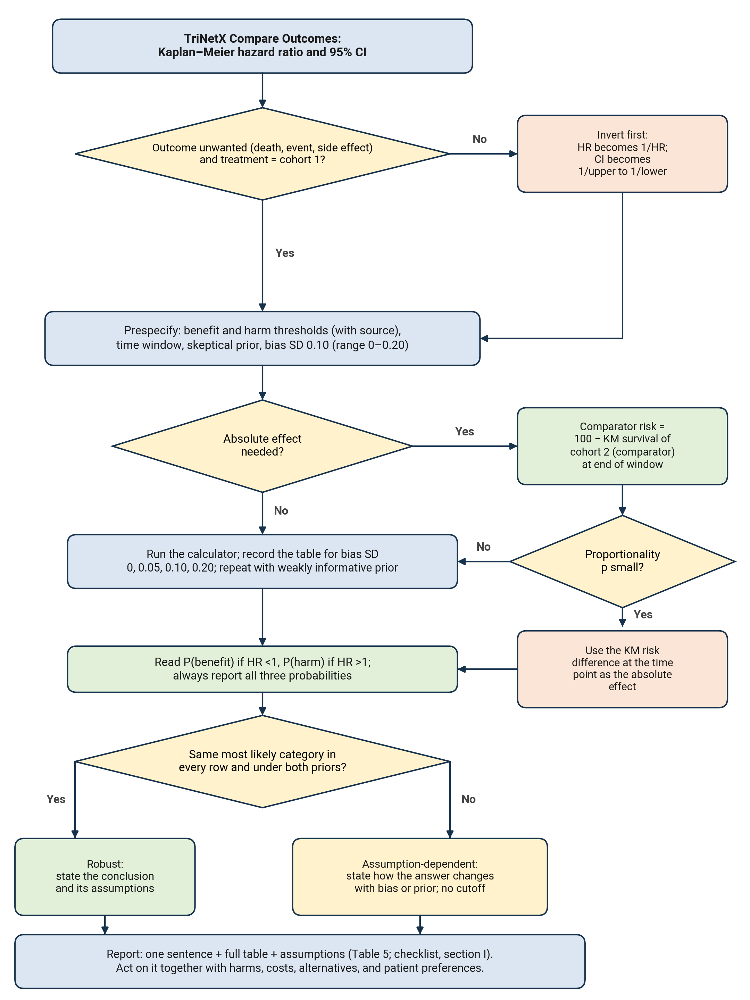

# Bayesian Reading of Hazard Ratios (version 1.1, November 2026)

> **How to cite.** If you use this calculator or code, please cite:
> Toraih EA, Hussein MH, Jishu JA, Elshazli R, Fawzy MS. Bayesian Reading of Hazard Ratios: calculator and simulation code (version 1.1). Zenodo; 2026. https://doi.org/10.5281/zenodo.24269191
>
> The accompanying article, "Interpreting Hazard Ratios From TriNetX: A Bayesian Method, Simulation, and Calculator", is in submission; its reference will be added here after publication. You can also click **"Cite this repository"** in the right sidebar for APA and BibTeX formats.

A free calculator that turns a hazard ratio (or risk ratio) and its 95% confidence interval, for example from TriNetX, into the probability that a treatment effect is large enough to matter, after allowing for systematic error (bias).

**Use it online:** https://emantoraih.github.io/trinetx-bayes-calculator/

**Archived version 1.1 (the version cited in the article):** https://doi.org/10.5281/zenodo.24269191. All versions: https://doi.org/10.5281/zenodo.24213482

## What it returns
- Posterior median hazard ratio (or risk ratio) with its 95% credible interval
- Probabilities of a meaningful benefit, an effect too small to matter, and meaningful harm (these add up to 100%), and the probability of any benefit
- Absolute effect in events per 1,000 patients, from the reported ratio and from the posterior (if the comparator risk is entered)
- A table showing how the answer changes with the allowance for systematic error
- A plain-language interpretation and a sentence for your Results section

## Using it with a TriNetX result: step by step

**Video walkthrough (5 minutes):** [How to use the calculator](https://github.com/emantoraih/trinetx-bayes-calculator/releases/download/v1.1/How_to_use_the_calculator_video.mp4)

1. **Prespecify** the outcomes, the meaningful benefit threshold and its source (a minimal clinically important difference, a guideline or GRADE default, a regulatory margin, or trial effect sizes), the time window, the skeptical prior, and the bias allowance (0.10, varied from 0 to 0.20).
2. **Check the direction.** The outcome should be unwanted (death, hospitalization, side effect) and the treatment should be cohort 1, so that HR < 1 means benefit. Otherwise invert: HR becomes 1/HR, and the CI becomes 1/upper to 1/lower.
3. **Hazard ratio and 95% CI:** Compare Outcomes, Kaplan–Meier analysis, Hazard Ratio table.
4. **Comparator risk:** 100 − the Kaplan–Meier "Survival Probability at End of Time Window" of the comparator cohort (cohort 2). Not the crude proportion with the outcome, which ignores patients lost to follow-up. With a landmark window (for example from day 366), the risk applies from the landmark onward.
5. **Proportional hazards:** if the proportionality test is clearly violated, report the Kaplan–Meier risk difference instead of the converted absolute effect.
6. **Run** with the skeptical prior and bias SD 0.10; record the sensitivity table (0 to 0.20); repeat with the weakly informative prior.
7. **Read** P(meaningful benefit) if HR < 1 and P(meaningful harm) if HR > 1, and report all three probabilities.
8. **Interpret the pattern, not a cutoff:** is the most likely category the same in every row and under both priors? The probability needed before acting depends on harms, costs, alternatives, and patient preferences.

## What to report
- Methods: model, prior, thresholds with their source, bias allowance and range, source of the comparator risk and time window.
- Results: the suggested sentence for the primary setting, plus the range across bias settings.
- Supplement: the full table (both priors × bias SD 0, 0.05, 0.10, 0.20), with posterior median HR, the three probabilities, and events per 1,000.

The full guide, with a benefit and a harm worked example and a 14-item author checklist, is in [`docs/Application_guide_TriNetX.docx`](docs/Application_guide_TriNetX.docx).

## Method
SE = [ln(upper) − ln(lower)] / 3.92, assuming a two-sided 95% interval calculated on the log scale. Total variance = SE² + σb². Normal prior on the log ratio (skeptical: mean 0, SD 0.136). The posterior is normal and is calculated in closed form. Probabilities are areas of the posterior below, between, and above the chosen thresholds (default 0.90 and exactly 1/0.90, shown as 1.11). The P value shown is an approximate Wald P value recalculated from the interval.

Absolute effect: for a hazard ratio, treated risk = 1 − (1 − p0)^HR under proportional hazards; for a risk ratio, treated risk = p0 × RR; if this exceeds 100% for the reported RR or its upper credible limit, the inputs are inconsistent and the absolute effect is not shown.

The allowance for systematic error is centered on zero. It widens the uncertainty but does not correct a bias that consistently favors one group.

## Files
- `index.html`: the calculator (single file, no external dependencies, runs entirely in the browser; no data are sent anywhere)
- `code/sim_v2.R`: simulation study and worked examples (R 4.5.1, data.table 1.17.8, openxlsx 4.2.9) (720 scenarios × 10,000 studies, seed 20261113)
- `docs/`: step-by-step guide (Word), flowchart
- `code/make_figures.py`: all figures (Python 3.13.9, matplotlib 3.10.6, pandas 2.3.3, NumPy 2.3.5, openpyxl 3.1.5, Pillow 12.3.0); run `python make_figures.py <folder with R output> <output folder>`

## Verification
The calculator's posterior estimates and probabilities agree with the R code to four decimal places for all three worked examples under every prior and allowance for systematic error (36 combinations, 252 values).

## Citation
Interpreting Hazard Ratios From TriNetX: A Bayesian Method, Simulation, and Calculator. [Journal, year, article DOI]

Software: Toraih EA, Hussein MH, Jishu JA, Elshazli R, Fawzy MS. Bayesian Reading of Hazard Ratios: calculator and simulation code (version 1.1). Zenodo; 2026. https://doi.org/10.5281/zenodo.24269191

Not affiliated with or endorsed by TriNetX, LLC.

## License
MIT
